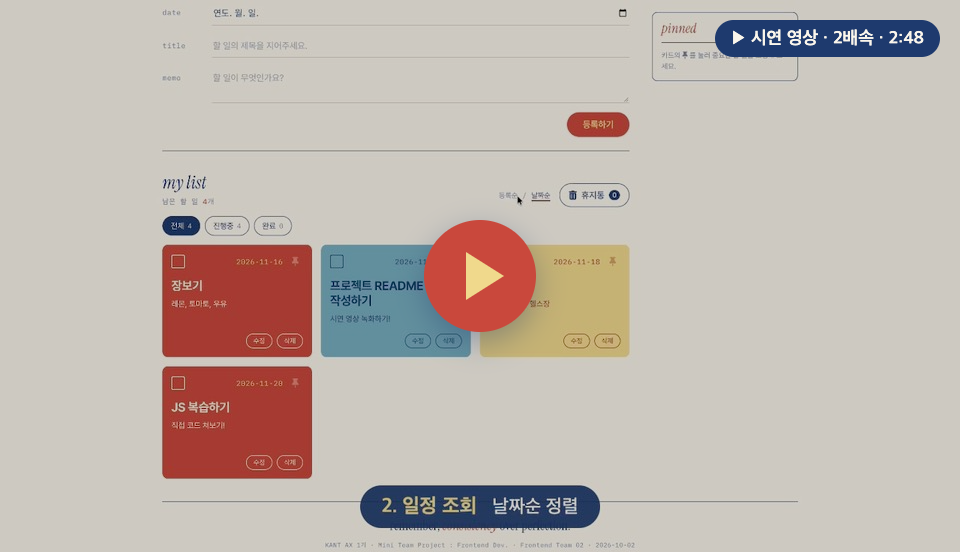
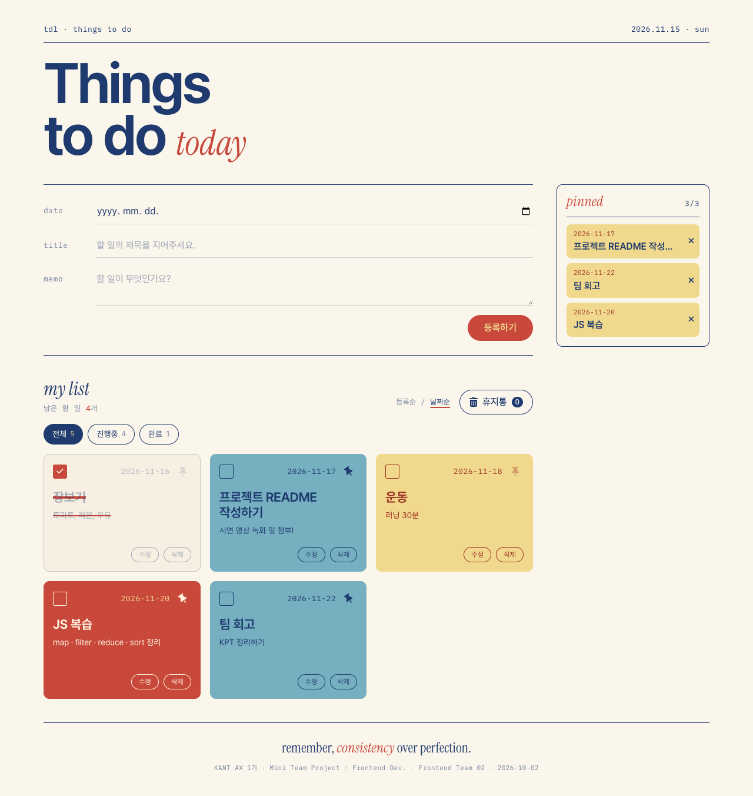
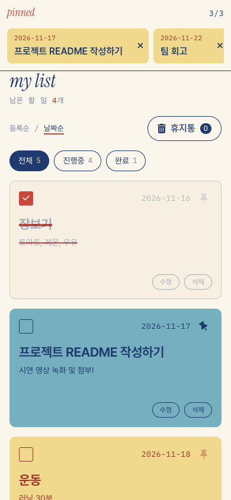

<h1 align="center">
  <br />
  Things to do <i>today</i>
</h1>

<p align="center">
  
  
  
  
  
  
</p>

<p align="center">
  <code>Higher-order Functions</code> <code>DOM</code> <code>Event Delegation</code> <code>localStorage</code> <code>CSS Variables</code> <code>Responsive</code>
</p>

<p align="center">
  HTML · CSS · JavaScript로 만든 할 일 관리 앱입니다.<br />
  일정을 <b>추가 · 조회 · 수정 · 삭제</b>할 수 있고, 새로고침해도 목록이 유지됩니다.<br />
  고차 함수로 데이터를 다루고, 이벤트 위임으로 동적 UI를 처리했습니다.
</p>

<br />

| 📅 작업 기간 | 📝 과제 |
|---|---|
| 1차 2026.09.29 ~ 10.02 · 2차 2026.11.14 ~ 11.15 | KANT AX 1기 프론트엔드 평가 과제 2 · Todo 리스트 만들기 (JavaScript) |

<br />

## 🎬 시연 영상

<a href="./readme/demo/tdl-demo-2x.mp4">
  
</a>

> ▶️ 이미지를 누르면 시연 영상(2배속 · 2분 48초)이 열립니다. 일정 추가 → 조회 → 수정 → 삭제 → 핀 고정 → 새로고침 후 유지 순서입니다.

<br />

## ✨ 주요 기능

| 기능 | 설명 |
|---|---|
| ➕ 일정 추가 | 날짜 · 제목 · 내용 입력 후 등록. 빈 칸이 있으면 안내 후 해당 칸으로 커서 이동 |
| 🔍 일정 조회 | 카드 목록으로 출력. 등록순 / 날짜순 정렬, 전체 / 진행중 / 완료 필터, 남은 할 일 개수 |
| ✏️ 일정 수정 | 폼에 기존 값이 채워지고 수정 모드로 전환. 취소 버튼 · Esc로 수정 취소 |
| 🗑️ 일정 삭제 | 휴지통으로 이동 → 복구 또는 영구삭제 |
| ✅ 완료 표시 | 카드가 바래고 제목 · 내용에 빨간 굵은 취소선 |
| 📌 핀 고정 | 중요한 할 일 최대 3개를 따라다니는 상자에 고정 |
| 💾 저장 | localStorage로 새로고침해도 목록 · 정렬 · 필터 · 핀 상태 유지 |

<br />

## 🛠️ 핵심 구현 포인트

| 구분 | 내용 |
|---|---|
| 🔁 고차 함수 | `map` · `filter` · `find` · `sort` · `reduce`로 새 배열을 만들어 교체, 정렬 · 필터 조건은 함수를 담은 객체로 관리 |
| 🖱️ 이벤트 위임 | 영역마다 리스너 하나로 모든 카드 버튼 처리, 완료 체크는 해당 카드만 갱신해 불필요한 DOM 재생성 감소 |
| 🎛️ 상태와 모양 분리 | JS는 `data-*` · `aria-pressed` · `hidden` 속성으로 상태만 표시, 모양은 CSS 속성 선택자와 `:root` 디자인 토큰이 결정 |
| 🛡️ 예외 처리 | 입력값 XSS 방지, 빈 값 · 손상된 저장값 · 핀 개수 초과 · 수정 중 삭제 처리 |

> 👉 코드 예시와 폴더 구조는 [구현 상세](./readme/implementation.md)에서 확인할 수 있습니다.

<br />

## 📸 스크린샷

<table>
  <tr>
    <th>데스크톱</th>
    <th>모바일</th>
  </tr>
  <tr>
    <td valign="top">
      
    </td>
    <td valign="top">
      
    </td>
  </tr>
</table>

<br />

## 🚀 실행 방법

```bash
git clone https://github.com/bsis09872-ux/things-to-do-today.git
```

저장소 폴더의 `index.html`을 브라우저로 엽니다. (별도 설치 없음)

> - 폰트(Pretendard 등)와 아이콘(Font Awesome)은 CDN에서 불러오므로 인터넷 연결이 필요합니다.
> - 반응형 확인: 개발자 도구(`F12`) → 기기 툴바(`Ctrl/Cmd + Shift + M`)에서 폭을 900px, 640px 이하로 바꿔 보세요.

<br />

## 📚 더 알아보기

<div align="center">
<table>
  <tr>
    <td align="center" valign="top" width="260">
      <br />
      <a href="./readme/implementation.md"><b>🛠️ 구현 상세</b></a>
      <br />
      <sub>고차 함수 · 이벤트 위임 · 폴더 구조</sub>
      <br />
      <br />
    </td>
    <td align="center" valign="top" width="260">
      <br />
      <a href="./readme/design.md"><b>🎨 디자인</b></a>
      <br />
      <sub>로고 · 팔레트 · 타이포 · 무드보드</sub>
      <br />
      <br />
    </td>
    <td align="center" valign="top" width="260">
      <br />
      <a href="./readme/retrospective.md"><b>💭 회고</b></a>
      <br />
      <sub>작업 기간 · 소감 · 배운 점</sub>
      <br />
      <br />
    </td>
  </tr>
  <tr>
    <td align="center" valign="top" width="260">
      <br />
      <a href="./readme/troubleshooting.md"><b>🧯 트러블슈팅</b></a>
      <br />
      <sub>입력값 출력 버그 수정 전 · 후</sub>
      <br />
      <br />
    </td>
    <td align="center" valign="top" width="260">
      <br />
      <a href="./readme/credits.md"><b>📎 출처 · 라이선스</b></a>
      <br />
      <sub>작업 도구 · 폰트 · 아이콘</sub>
      <br />
      <br />
    </td>
    <td width="260"></td>
  </tr>
</table>
</div>
