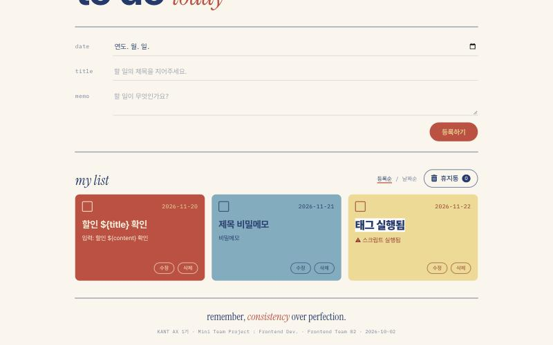
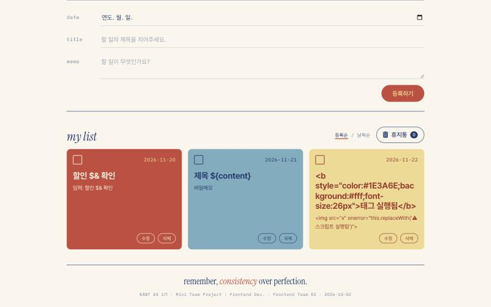

# 트러블슈팅 기록

## 1. 할일 제목·내용에 입력한 글자가 그대로 보이지 않는 문제 (2026-11-15)

### 증상

할일을 등록할 때 특정 문자를 넣으면 입력한 글자와 다르게 화면에 나왔습니다. 같은 원인에서 나온 증상 3가지입니다.

| # | 입력한 제목 | 화면에 나온 결과 | 문제 |
|---|---|---|---|
| 1 | `할인 $& 확인` | `할인 ${title} 확인` | `$&`가 다른 글자로 바뀜 |
| 2 | `제목 ${content}` | `제목 비밀메모` | 내 제목에 다른 칸(내용)의 값이 끼어듦 |
| 3 | `<b ...>태그 실행됨</b>` / `` | 굵은 글씨로 표시, `onerror` 스크립트까지 실행 | 입력값이 HTML 태그로 실행됨 (XSS) |

**수정 전 화면**



- 1번 카드: 제목과 내용의 `$&`가 `${title}`, `${content}`로 바뀌어 나옴
- 2번 카드: 제목에 쓴 `${content}`가 내용 값(`비밀메모`)으로 바뀜
- 3번 카드: 제목이 굵은 태그로 그려지고, 내용의 이미지 태그가 `onerror` 스크립트를 실행해 "⚠ 스크립트 실행됨"으로 바뀜

### 원인

할일 카드 HTML은 템플릿(`<script type="text/html" id="tpl">`)의 `${title}`, `${content}` 같은 자리에 값을 바꿔 넣어 만듭니다. 수정 전 코드는 다음과 같았습니다.

```js
toHtml(item, tplId) {
    return Object.entries(item).reduce(
        (html, [key, value]) => html.replaceAll(`\${${key}}`, value),
        this.getTpl(tplId)
    );
},
```

1. **`$&` 문제:** `replaceAll(찾을문자, 바꿀문자열)`에서 바꿀 문자열 안의 `$&`, `` $` ``, `$'`는 "찾은 문자열" 같은 특수 기호로 해석됩니다. 그래서 `$&`가 찾은 문자열인 `${title}`로 바뀌었습니다.
2. **`${content}` 문제:** `uid → date → title → content` 순서로 한 칸씩 차례로 바꾸다 보니, 먼저 들어간 제목 안의 `${content}`가 다음 차례에서 내용 값으로 또 바뀌었습니다.
3. **태그 실행 문제:** 사용자 입력을 그대로 HTML 문자열에 넣고 `innerHTML`로 출력해서, `<`, `>`가 태그로 해석됐습니다. `onerror` 같은 속성을 쓰면 임의의 스크립트까지 실행될 수 있습니다.

### 해결

```js
// HTML 특수문자 -> 문자 그대로 보이도록 바꿀 값
const HTML_ENTITIES = { "&": "&amp;", "<": "&lt;", ">": "&gt;", '"': "&quot;", "'": "&#39;" };

// 사용자 입력을 화면에 넣기 전에 특수문자 치환 (태그 실행 방지)
const escapeHtml = value => String(value).replace(/[&<>"']/g, ch => HTML_ENTITIES[ch]);

toHtml(item, tplId) {
    return this.getTpl(tplId).replace(/\$\{(\w+)\}/g, (placeholder, key) =>
        key in item ? escapeHtml(item[key]) : placeholder
    );
},
```

- **한 번만 훑기:** 정규식 `/\$\{(\w+)\}/g`로 템플릿을 한 번만 훑으면서 각 자리를 바꿉니다. 이미 넣은 값은 다시 검사하지 않아서 2번 문제가 사라집니다.
- **함수로 값 넘기기:** 바꿀 값을 문자열이 아니라 함수의 반환값으로 넘기면 `$&` 같은 특수 기호가 해석되지 않습니다(1번 해결).
- **특수문자 치환:** `escapeHtml`로 `& < > " '`를 문자 그대로 보이는 값으로 바꿔 넣어서, 입력값이 태그로 실행되지 않습니다(3번 해결).
- **수정 폼은 그대로 안전:** 수정 버튼을 누를 때는 `input.value`에 원래 값을 넣기 때문에, 화면에는 치환된 값이 보여도 수정 폼에는 입력한 글자 그대로 들어갑니다.

### 확인

같은 값을 다시 입력해 확인했습니다.



- 세 카드 모두 제목·내용이 입력한 글자 그대로 출력됨
- 목록과 휴지통 안에 `<b>`, `` 태그가 생기지 않고 스크립트도 실행되지 않음
- 수정 버튼을 누르면 폼에 원래 입력값이 그대로 들어감
- 완료 표시, 휴지통 이동, 복구 정상 동작
